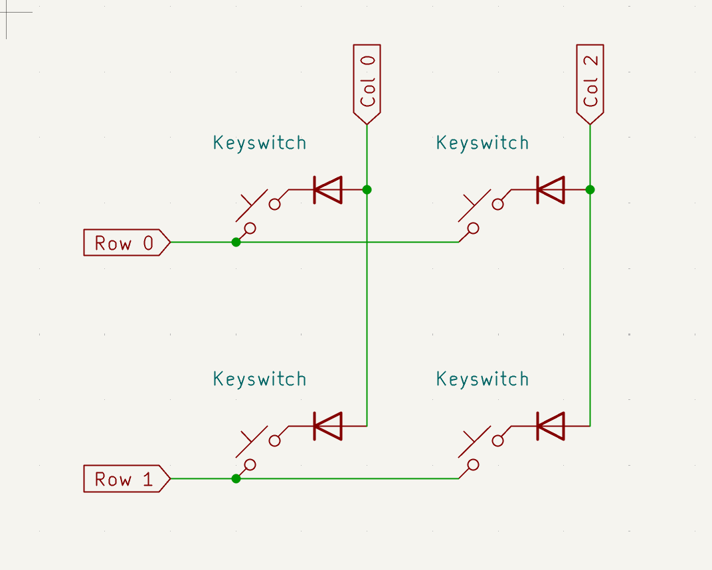

# Left handwire testing notes

Updated: 2026-11-01. Branch: `left-handwire-test`.

## USB scan logging for Num and Space

The user verified both switch/diode connections in an isolated test. Columns are confirmed P1.11 (Num) and P1.13 (Space); do not change these assignments based on the missing output alone.

`build.yaml` now additionally builds `raven-left-usb-debug` using the upstream `zmk-usb-logging` snippet. The normal build is retained. Flash the debug UF2 and connect via a USB data cable. On Windows, find its COM port in Device Manager and open it in a serial terminal (for example PuTTY, 115200 baud).

Press working Alt, then Num, then Space individually, and capture press/release logs:

- Alt: `Sending event at 3,2`, then `Row: 3, col: 2, position: 21`.
- Num: `Sending event at 3,1`, then `Row: 3, col: 1, position: 22`.
- Space: `Sending event at 3,0`, then `Row: 3, col: 0, position: 23`.

These are expected patterns, not results observed on the hardware. Missing scanner events narrow the failure to scanning/input detection; scanner events followed by transform errors indicate mapping; correct position events with no host output direct investigation toward behaviors/HID. Include surrounding warnings/errors. Keep the existing FN probes available as a separate binding check. Remove the additional logging build after diagnosis.

## Num / Space diagnostic probes

With normal typing working except Num and Space, the FN layer temporarily maps the physical Num key to `1` and Space to `2`. Hold the working FN key and press each switch separately. FN+Q should send F2 as a control that FN is active.

- If FN+Num sends `1` and FN+Space sends `2`, both switch positions register; investigate the normal bindings/layer behavior next.
- If either is silent while FN+Q sends F2, changing the binding did not restore that position. Inspect its switch, diode, and matrix connections; this does not prove the exact failed component.
- Num is row P1.15 / column P1.11; Space is row P1.15 / column P1.13.
- Other bottom-row keys work, so inspect the P1.15 row-wire segment toward Num and Space, plus their individual solder joints and diode orientation. R/F/V and T/G/B can confirm those column paths work elsewhere.
- Normal Base and Num layers, pin assignments, and the transform are unchanged. Restore the final two FN bottom-row bindings to `&trans` after diagnosis.

## Keymap selection correction

The reported individual outputs (QWERT, then U/I/O/P/Backspace, then A/S/D/F/G) match the original 42-position split map being applied to the 24-position left transform. The keymap previously tested `CONFIG_SHIELD_RAVEN_LEFT`, a Kconfig symbol unavailable during the initial devicetree preprocessing pass, so it selected the original map.

The left overlay now defines `RAVEN_LEFT_HANDWIRE` before the keymap is preprocessed. The keymap selects the 24-key left branch using that explicit marker. The right overlay does not define it and retains the original split keymap. Pin assignments and transform are unchanged by this correction.

After rebuilding and flashing, individual rows should be Tab/Q/W/E/R/T, Esc/A/S/D/F/G, Shift/Z/X/C/V/B, and Ctrl/GUI/FN/Alt/Num/Space. Hold FN for F1-F6 on the first row and F7-F12 on the second row.

## Confirmed full pin mapping (supersedes earlier scan notes)

The user confirmed the full pin order with T as the top-right anchor:

- Physical rows, top to bottom: P0.31, P0.29, P0.02, P1.15.
- Physical columns, right to left: P1.13, P1.11, P0.10, P0.09, P1.06, P1.04.
- Rows are active-high inputs with pull-downs; columns are active-high outputs.
- `diode-direction = "col2row"` now matches both the physical wiring and firmware arrays. T still drives P1.13 and senses P0.31; its electrical path has not changed.
- The previous overlay had P0.31 and P1.13 assigned to opposite GPIO arrays and incorrectly used P0.08 instead of P0.09. Those assignments could test T but did not represent the complete matrix.
- The existing reversed-column transform is retained: T is RC(0,0), at binding 5. Full keymap and FN behavior are unchanged.
- Soft-off wake is configured for F: drive P1.11, sense P0.29. Hardware wake still needs testing.

The older scan-direction, GPIO table, and inferred-mapping sections below describe the previous diagnostic configuration, not the current overlay. The full pin order is now user-confirmed; every switch still needs validation with the corrected firmware.

## Current keymap update

The left blank test map described below has been replaced with a usable 24-key map.
The wiring and transform verification notes below remain relevant.

```text
Tab    Q      W      E      R      T
Esc    A      S      D      F      G
Shift  Z      X      C      V      B
Ctrl   GUI    FN     Alt    Num    Space
```

- Z is a plain letter; GUI has its own key below Z.
- FN is momentary: hold to access F1-F6 on the top row and F7-F12 on the second row; release to return.
- Num preserves hold for momentary access, tap for sticky access, and double tap to switch. Press Num again to leave the switched Num layer.
- Num contains the original left numbers, symbols, and arrows. Esc remains Esc on Num, and Shift/Ctrl follow their new physical positions.
- Shift and Ctrl preserve the original hold modifier / tap sticky modifier behavior.
- The left map uses local layer indices Base=0, Num=1, FN=2. The original right/shared keymap remains in the other conditional branch unchanged.
- This is the current left-only testing configuration. Pairing with the right half will require a unified transform and keymap; the left-only indices are not a finished split layout.

## Scope

Test a left 6-column by 4-row ortholinear handwire, eventually paired with the existing Raven right split. Preserve the right split's pin configuration and existing keymap. Do not change shared matrix settings to fix left-only wiring.

The left overlay overrides the shared transform and scan settings. `raven.keymap` selects a blank test keymap under the left-overlay marker `RAVEN_LEFT_HANDWIRE`; the original keymap remains in the other branch of that conditional.

## Confirmed working wiring

**Hardware result:** the user confirmed T works with the intended connections after the scan-direction correction. Keep these connections; swapping the plugs is not required.



[Open the original wiring schematic](wiring.png). This is the user's final schematic and the primary reference for diode orientation. Its generic row/column labels describe physical wires, not the current firmware GPIO arrays. The drawing illustrates the circuit topology; it does not establish every GPIO or key position.

For the top-right T reference switch:

| Connection | Physical role in the schematic | Current firmware role |
| --- | --- | --- |
| P0.31 (`031`) -> switch pin 1 | Horizontal row wire | `col-gpios[0]`, input with pull-down |
| P1.13 (`113`) -> diode anode | Vertical column wire | `row-gpios[0]`, active-high output |
| Diode cathode (bar / striped end) -> switch pin 2 | Diode faces the switch | Conducts toward the switch and sensed input |

When the switch closes, conventional current follows:

```text
P1.13 output -> diode anode -> diode cathode -> switch pin 2
             -> closed switch -> switch pin 1 -> P0.31 input
```

The diode's **bar / striped end is toward switch pin 2**, not toward the physical column wire. Switch pin 1 and pin 2 are the user's reference names for the two switch terminals.

In the schematic's physical terminology, this is **column-to-row** flow. In the current firmware arrays, it is **row-to-column**, so the working setting is `diode-direction = "row2col"`. The setting follows the firmware arrays, not how a wire looks from the keycap side.

## Where debugging got lost

The repeated failures came from combining several different questions and changing assumptions between tests:

1. **Temporary plugs versus intended wiring.** The earlier image had both "current" and "correct" pin labels. "Current" described the reversed test plugs, whereas the intended connections were pin 1 -> P0.31 and the diode-side wire -> P1.13. The first fix mistakenly retained the temporary plug arrangement. The embedded final schematic replaces that earlier image.
2. **Diode polarity was read backwards.** Earlier notes incorrectly put the cathode on the physical column wire. The final schematic puts the cathode toward the switch. A direction change also requires moving the input pull-downs to the pins being sensed; changing just the direction string is insufficient.
3. **Physical and firmware row/column names were mixed.** P0.31 looks like a physical row but is currently in `col-gpios`; P1.13 looks like a physical column but is in `row-gpios`. Saying only "use col2row" was ambiguous. Always state the actual drive and sense pins first: **drive P1.13, sense P0.31**.
4. **Electrical index was confused with physical position.** T is the sixth key from the left, viewed from the keycap side. Its current electrical coordinate is `RC(0,0)`, which the transform places at the sixth binding. Firmware column index 0 does not mean the physical leftmost key.
5. **A detected key was mistaken for a complete layout check.** Getting Tab instead of T showed that a keypress was detected, but the transform/keymap assigned the wrong action. Getting T from one switch does not validate the other GPIOs or the full matrix.

Before future changes, record the physical endpoints, diode stripe location, driven GPIO, sensed GPIO, and expected electrical coordinate. Keep the intended plugs fixed while testing scan direction. Verify detection first, then position mapping. Do not swap the plugs and change the firmware direction in the same test.

The generated [4x4 reference SVG](wiring-4x4.svg) is supplementary. It illustrates the same diode path, but its T position is illustrative and it does not specify the rest of the keyboard's GPIOs.

## Current GPIO assignments

`031` means P0.31; `111` means P1.11, **not P0.11**.

| Electrical row index | GPIO |
| --- | --- |
| 0 | P1.13 |
| 1 | P0.29 |
| 2 | P0.02 |
| 3 | P1.15 |

| Electrical column index | GPIO |
| --- | --- |
| 0 | P0.31 |
| 1 | P1.11 |
| 2 | P0.10 |
| 3 | P0.08 |
| 4 | P1.06 |
| 5 | P1.04 |

The left scanner uses `row2col`: rows are active-high outputs, columns are active-high inputs with pull-downs. This matches the confirmed electrical path above. Do not infer diode direction solely from which wire is called a physical row or column.

UART0 is disabled on the left because P0.08 is a matrix column. Soft-off wakeup uses electrical row 1 (P0.29) as output and column 4 (P1.06) as input.

## Physical transform and blank keymap

Three separate mappings are involved:

1. GPIO array indices determine the electrical matrix coordinate.
2. The matrix transform orders those coordinates into physical key positions.
3. Keymap bindings assign actions to those ordered positions.

The current transform places firmware row indices top to bottom and reverses firmware column indices in keymap order. This is the configured mapping, not a verified description of every physical wire:

```text
RC(0,5) RC(0,4) RC(0,3) RC(0,2) RC(0,1) RC(0,0)
RC(1,5) RC(1,4) RC(1,3) RC(1,2) RC(1,1) RC(1,0)
RC(2,5) RC(2,4) RC(2,3) RC(2,2) RC(2,1) RC(2,0)
RC(3,5) RC(3,4) RC(3,3) RC(3,2) RC(3,1) RC(3,0)
```

The test keymap, in physical order, is:

```text
none none none none none T
none none none none none none
none none none none none none
none none none none none none
```

Only the top-right reference switch is assigned an action. Other switches intentionally produce no output (`&none`).

**Still to verify:** the full column reversal and remaining row order are inferred from the reference switch and the earlier pin list. They have not been established by testing every position. The earlier claim that the column GPIO list ran left to right conflicts with the confirmed top-right switch. Keep the distinction between confirmed wiring and inferred physical order.

Both assigning T directly to the first electrical position and transforming that position to the top-right T binding produce the same output for this single switch. That switch alone cannot validate the entire transform. Before filling the keymap, temporarily assign distinct keys to other positions and verify them from the keycap side.

## Relevant files

- `boards/shields/raven/raven_left.overlay`: left pins, scan polarity, physical transform, wakeup pins.
- `boards/shields/raven/raven.keymap`: conditional left test map and preserved original map.
- `boards/shields/raven/raven_right.overlay`: existing right split; preserve it.
- `boards/shields/raven/raven.dtsi`: shared defaults; left overrides them.
- `wiring.png`: user-created final schematic embedded above; physical wire topology and diode orientation.
- `wiring-4x4.svg`: supplementary illustration, not a complete GPIO assignment diagram.

## Build and flash

```powershell
git branch --show-current
git add boards/shields/raven/raven_left.overlay boards/shields/raven/raven.keymap HANDWIRE_TESTING.md wiring.png wiring-4x4.svg
git commit -m "Document and configure left handwire test layout"
git push -u origin left-handwire-test
```

The push triggers the repository's GitHub Actions firmware workflow. Download the successful run's firmware artifact, extract it, and flash only the `raven_left` UF2 to the left controller in bootloader mode. Keep the existing right controller firmware.

Local firmware builds have not been run in this session because `west` is unavailable. Whitespace/diff checks passed for the latest code edits; the user confirmed the intended T wiring works. The rest of the matrix, full transform, and soft-off wakeup still need hardware validation.
